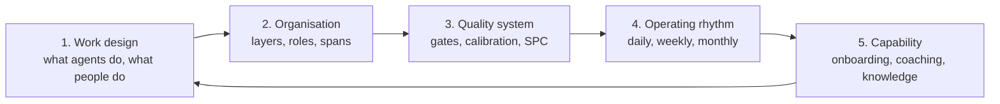

# AI-Native Operating Model

How to run a large, distributed delivery organisation in which **AI agents do the repeatable work and people handle judgement, exceptions and relationships**, without trading away quality or control.

This repo is the model I use to think about that problem: the structure, the decision rights, the operating rhythm, the onboarding system, and the numbers that tell you it is working. It is written as an operating handbook, with diagrams, templates and a case study, and it links to the working code in the companion repos.

> The examples are generalised and the data is synthetic. Nothing here is confidential employer information. Figures in the case study are the ones on my résumé.

## The core idea

Most AI programmes automate tasks. A delivery organisation is not a task list: it is **people, standards, hand-offs and a review rhythm**. Automating a task inside an organisation that has not decided who owns its errors simply moves the failure somewhere harder to see. The operating model has five parts that have to be designed together:

| Part | Question it answers | Detail | Working code |
|---|---|---|---|
| Work design | Which work should agents do alone, with approval, or not at all? | [docs/01-human-agent-work-design.md](docs/01-human-agent-work-design.md) | [`ai-workforce-design-playbook`](https://github.com/MohitBhatnnagar/ai-workforce-design-playbook), [`agentflow-hitl`](https://github.com/MohitBhatnnagar/agentflow-hitl) |
| Organisation | How do you lead 300 people through managers, consistently? | [docs/02-organisation-design.md](docs/02-organisation-design.md) | |
| Quality system | How do you raise quality and productivity together? | [docs/03-quality-and-rhythm.md](docs/03-quality-and-rhythm.md) | [`ai-quality-and-evals`](https://github.com/MohitBhatnnagar/ai-quality-and-evals) |
| Operating rhythm | What is reviewed, by whom, how often, and what triggers escalation? | [docs/03-quality-and-rhythm.md](docs/03-quality-and-rhythm.md) | [`ops-mcp-server`](https://github.com/MohitBhatnnagar/ops-mcp-server) |
| Capability | How do new people become productive fast without pulling experts off the work? | [docs/04-onboarding-system.md](docs/04-onboarding-system.md) | |
| Economics and risk | Is it worth it, and is it governed? | | [`automation-business-case`](https://github.com/MohitBhatnnagar/automation-business-case), [`ai-governance-framework`](https://github.com/MohitBhatnnagar/ai-governance-framework) |

Technical building blocks for the agent layer: [`agentic-ai-patterns`](https://github.com/MohitBhatnnagar/agentic-ai-patterns) (ReAct, plan-and-execute, reflection with guardrails).

## Principles

1. **Fix the process before automating it.** Automation scales whatever you give it, including defects.
2. **Quality and productivity must be measured together.** If one moves without the other you are trading, not improving.
3. **Autonomy is granted by evidence, not by demo.** Shadow mode, then approval, then unattended, and only while yield and override rate hold.
4. **Every automation has a human owner for its exceptions,** a named kill-switch holder, and an audit trail.
5. **Lead through managers.** A director who does the work of team leads has built a bottleneck. Expectations, coaching and ownership are the product.
6. **Know the unit economics.** Capacity, utilisation, cost per task and demand forecasts are management tools, not finance reports.
7. **Standards are shared, not personal.** Calibrate reviewers on the same items until two people reach the same verdict.

## Reading order

1. [Case study](docs/05-case-study.md) for the story and the results.
2. [Work design](docs/01-human-agent-work-design.md), then [Organisation](docs/02-organisation-design.md).
3. [Quality and rhythm](docs/03-quality-and-rhythm.md), then [Onboarding](docs/04-onboarding-system.md).
4. Companion repos for the code and tools.

## About

Mohit Bhatnagar: operations leader, 16+ years running service businesses, most recently Director, Operations Excellence and Delivery at an AI SaaS company, running a 300+ person distributed delivery organisation serving US clients. Lean Six Sigma Black Belt. LinkedIn: https://www.linkedin.com/in/mohitbhatnagar-ai/

## License

MIT
