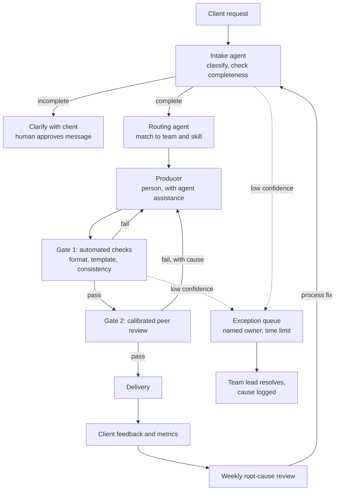

# 1. Human-agent work design

## The three autonomy levels

| Level | Agent does | Human does | Use for |
|---|---|---|---|
| **Auto** | The whole task, unattended | Samples output, handles escalations | High-volume, rule-like, reversible, low impact |
| **Approve** | The work, up to the point it takes effect | Approves or rejects before release | Client-visible or irreversible output, moderate confidence |
| **Human** | Prepares inputs, drafts options | Decides | High-impact and irreversible, or poor automation fit |

Which level a task gets is decided by scoring **fit** and **risk** separately (method and tool in [`ai-workforce-design-playbook`](https://github.com/MohitBhatnnagar/ai-workforce-design-playbook)) and enforced at run time by a policy that can only move work *toward* more human involvement when confidence is low (see [`agentflow-hitl`](https://github.com/MohitBhatnnagar/agentflow-hitl)).

## A delivery flow, redesigned

Notes on the design:

- Agents sit at **intake, routing and Gate 1**, where the work is rule-like and a wrong output is cheap to catch and undo.
- People own **production judgement and Gate 2**, and every failure is logged with a root cause category.
- The **exception queue** is not a side channel. It has an owner, a time limit and a weekly review, because exceptions are where the process is telling you what to fix.
- Low-confidence agent output is **held for review**, not discarded and not shipped.

## Decision rights

For every automated step, write down who can start it, who approves, who owns the result and who can stop it. A single-line RACI per workflow is enough. If nobody can name the owner of an automation's errors, it should not run unattended.

## What changes for people

- Producers spend less time on assembly and more on judgement and client understanding.
- Reviewers' work shifts from catching mechanical defects (now Gate 1) to judgement. This needs **calibration**, so reviewers apply one standard.
- Team leads spend more time on exceptions, coaching and root causes, and less on routing and chasing.
- New skills worth training for: writing clear briefs, reviewing agent output critically, reading control charts, running a root-cause review.

## Measuring the redesign

| Metric | Healthy sign |
|---|---|
| First-pass yield by gate | Rising at Gate 1, stable or rising at Gate 2 |
| Exception rate and time to resolve | Falling rate, short resolution time |
| Human override rate on agent output | Low and stable (rising means drift or a loose policy) |
| Hours per delivered item | Falling, with yield not falling |
| Where freed hours went | Named, and visible in volume or quality |
