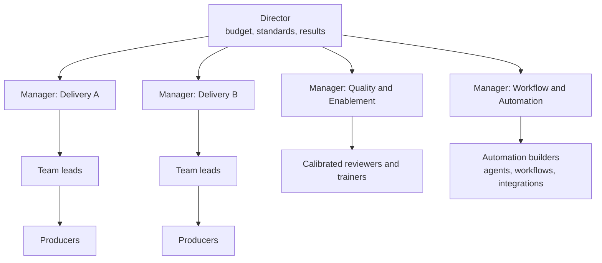

# 2. Organisation design for a distributed delivery centre

## The shape

This is an illustration of the structure, not a depiction of any specific company. The principles matter more than the boxes.

## Principles

**One management approach, not many.** With 300 people and a dozen team leads, inconsistency is the main risk: the same behaviour rewarded in one team and penalised in another. Fix this with a short, written set of expectations, one performance rhythm, and shared templates for one-to-ones and reviews.

**Build a second line.** Team leads should be developed into managers who run day-to-day operations without escalating every decision. Method: regular one-to-ones, structured feedback, clear ownership of a metric, and gradual delegation of decisions with a visible boundary.

**Separate the quality function from production.** Reviewers, trainers and standards owners report outside the production lines so that the standard does not bend under delivery pressure.

**Make automation a team, not a hobby.** Automation builders sit with operations, own a backlog ranked by the playbook's priority score, and are measured on hours returned and yield, not workflows shipped.

**Span of control.** Team leads with roughly eight to twelve producers can coach properly; much beyond that, coaching degrades into supervision. Managers with five to eight leads can still hold meaningful one-to-ones.

## The people lifecycle

| Stage | What good looks like |
|---|---|
| Hiring plan | Driven by the demand forecast and capacity model, with lead time and attrition in the plan |
| Interviews | Structured, with a work sample, scored against the same rubric |
| Onboarding | A defined programme with a buddy, shadowing, a first supervised task, and a 30-day objective review (see [onboarding](04-onboarding-system.md)) |
| Objectives | A few, measurable, linked to the quality and productivity metrics |
| Performance | Regular review; calibration across team leads so ratings mean the same thing |
| Underperformance | Early, direct conversation, clear expectations, coaching and a follow-up date. Never quietly taking over the work |
| Development | A path from producer to reviewer, trainer, team lead |
| Exits | Handled with dignity, knowledge captured |

## Budget and capacity

- Own a budget and tie every resourcing decision to cost and to a delivery commitment.
- Forecast incoming demand and convert it to capacity, allocation and hiring plans, giving leadership early sight of pressure points (see [`automation-business-case`](https://github.com/MohitBhatnnagar/automation-business-case)).
- Track utilisation by team. Sustained overload means rebalancing priorities, not asking for more effort.
- The unit economics goal: volume can grow without cost growing at the same rate.

## Governance and compliance

Work with finance, legal counsel and auditors on statutory and regulatory compliance. Be an active member of workplace committees (for example one handling harassment prevention). Tier AI use cases by risk and name an approver for each (see [`ai-governance-framework`](https://github.com/MohitBhatnnagar/ai-governance-framework)).

## Working across time zones

- Make overlap hours explicit, and protect them for decisions that need talking.
- Everything else is asynchronous by default: written hand-offs, a clear definition of done, and a daily status that says what is blocked and who owns it.
- Escalation paths must work when the director is asleep: named owners, time limits, and authority to decide.
