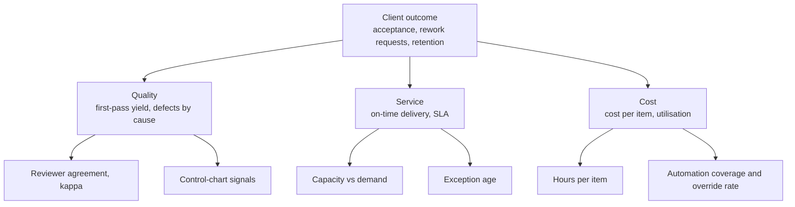

# 3. Quality system and operating rhythm

## Raising quality and productivity together

These usually pull against each other: pressure on volume erodes quality, and extra checking slows output. They move together when you stop relying on end-of-line inspection and instead fix causes.

The sequence that works:

1. **Measure first-pass yield, not final quality.** Rework hides in the final number.
2. **Rebuild the quality gates** so mechanical defects are caught early and cheaply (often by automation) and reviewers spend time on judgement.
3. **Calibrate reviewers** on shared samples until agreement is high, so the standard does not depend on who reviews.
4. **Run root-cause reviews** on recurring errors and fix the process (brief, template, checklist, intake rule), not the single deliverable.
5. **Use control charts** to tell a real shift from noise, so you act when you should and not when you should not.
6. **Automate the repeatable checks and reporting,** keeping people on review, exceptions and escalation.

Details, formulas and code: [`ai-quality-and-evals`](https://github.com/MohitBhatnnagar/ai-quality-and-evals).

## The KPI tree

Each leaf has one owner and one review cadence. A metric with no owner is decoration.

## Operating rhythm

| Cadence | Forum | Inputs | Outputs |
|---|---|---|---|
| **Daily** | Short stand-up per team, then exceptions review | Overnight queue, at-risk items, blocked work | Reassignments, escalations. No dashboards read aloud |
| **Weekly** | Operations review | Control charts, Pareto of defect causes, capacity vs demand, exception age | Process fixes with owners and dates |
| **Weekly** | Team lead one-to-ones | Objectives, coaching topics | Feedback, development actions |
| **Monthly** | Reviewer calibration | Shared sample of delivered work | Updated standard, recalibration list |
| **Monthly** | Leadership review | Quality, service, cost, risk, people | Decisions, budget and hiring changes |
| **Quarterly** | Strategy and governance | Forecast, automation roadmap, incident trends | Priorities, re-tiering, investment |

## Escalation

- Define triggers in observable terms: SLA at risk, two or more items at risk in one team, a control-chart signal, a client escalation, any safety, data or compliance concern.
- Every trigger has a named owner and a time limit.
- Escalations are logged with their cause. The weekly review looks for repeated causes.

## Reporting to global leadership

- One page, same layout every time: the four to six headline metrics, trend and signal status, top three risks, decisions needed.
- Report variation honestly with limits, and say what you are doing about it. Leadership trusts a leader who reports a bad week with a cause and a fix.
