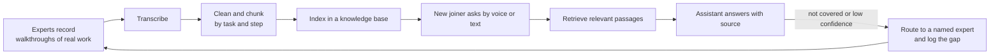

# 4. An onboarding system new joiners can talk to

## The problem

In a fast-growing delivery organisation, experts are the scarcest resource and new joiners are the biggest drain on them. Every "quick question" interrupts senior work, and the same questions repeat. Recorded training helps, but nobody scrolls through hours of video to find one answer.

## The approach

Capture expert knowledge once, in the experts' own voice, then make it **askable**.

Tooling used in this approach: voice capture and transcription (Wispr Flow), a knowledge and workflow platform (Dify), large language models (Claude, plus a conversational Grok bot for voice interaction).

## Design decisions

- **Walkthroughs of real work, not slides.** Experts narrate while doing the task, which captures the judgement and the exceptions that documentation leaves out.
- **Answers cite the source passage.** New joiners can open the original recording or SOP, and experts can see which material is used.
- **Honest abstention.** If retrieval is weak the assistant says so and routes the question to a named expert, instead of guessing. The gap is logged and becomes the next recording.
- **Evaluate before launch.** Build a golden question set from real new-joiner questions and measure retrieval (see [`ai-quality-and-evals`](https://github.com/MohitBhatnnagar/ai-quality-and-evals), including why lexical-only retrieval fails on paraphrased questions).
- **Governance.** An internal assistant on company knowledge is a medium-tier use case in the [governance framework](https://github.com/MohitBhatnnagar/ai-governance-framework): owner, sampled review, escalation path, evaluation before launch.

## The programme around the assistant

An assistant does not replace onboarding design. Pair it with:

1. A defined two-week programme: tool access and security in week one, shadowing and a first supervised task in week two.
2. A buddy for each new joiner.
3. A 30-day review with the team lead to set objectives.
4. SOPs and playbooks that make good performance repeatable.

## Metrics

| Metric | Why |
|---|---|
| Time for senior staff spent answering new-joiner questions | The cost you are removing |
| Time to first independent delivery, and its first-pass yield | The outcome you want |
| Share of questions answered without escalation | Coverage |
| Unanswered-question log, by topic | The backlog for the next recordings |
| New-joiner satisfaction and 30-day review scores | Experience and ramp quality |

My résumé reports results from this approach (about two hours a day returned to experts and new joiners about 60% more productive). See the [case study](05-case-study.md).
